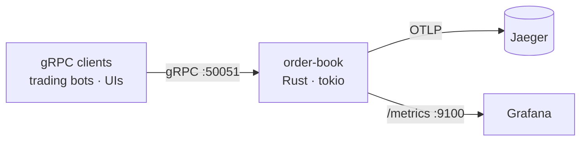
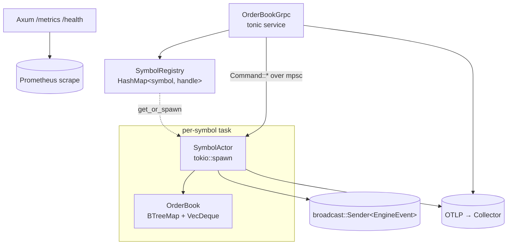
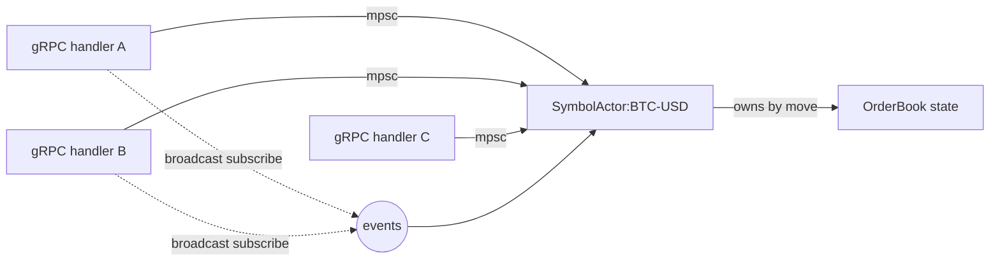

# Architecture

## C4 — Level 1: System Context



## C4 — Level 2: Containers (process-internal)



## Match flow (limit crosses resting order)

```mermaid
sequenceDiagram
    autonumber
    participant client as gRPC client
    participant svc as OrderBookGrpc
    participant reg as SymbolRegistry
    participant actor as SymbolActor
    participant book as OrderBook

    client->>svc: PlaceOrder(symbol="BTC-USD", side=BUY, limit, 100, qty=5)
    svc->>reg: get_or_spawn("BTC-USD")
    reg-->>svc: SymbolHandle
    svc->>actor: mpsc send Command::Place { order, reply }
    actor->>book: place(order)
    Note over book: matches against best ask,<br/>emits Trades,<br/>rests residual if any
    book-->>actor: PlaceOutcome { trades, remaining }
    actor->>actor: broadcast events, update metrics
    actor-->>svc: oneshot reply
    svc-->>client: PlaceOrderResponse { trades, remaining }
```

## Cancel flow

```mermaid
sequenceDiagram
    autonumber
    participant client as gRPC client
    participant svc as OrderBookGrpc
    participant actor as SymbolActor
    participant book as OrderBook

    client->>svc: CancelOrder(symbol, order_id)
    svc->>actor: Command::Cancel { id }
    actor->>book: cancel(id)
    Note over book: index lookup → level lookup → VecDeque::remove
    book-->>actor: Some(remaining_qty) | None
    actor->>actor: broadcast OrderCancelled if removed
    actor-->>svc: reply
    svc-->>client: { removed, remaining_qty }
```

## Concurrency model — why there are no locks



- One `SymbolActor` per symbol, spawned on first request.
- The book is *moved into* the task on spawn; nothing else can name it.
- Callers race for a slot in the mpsc mailbox; the actor processes strictly one command at a time.
- Fan-out for market data is a `broadcast::Sender` — slow subscribers get `RecvError::Lagged` and never block the actor.

## Data structure

```
Bids                                Asks
BTreeMap<Price desc>                BTreeMap<Price asc>
────────────────────                ────────────────────
101  →  [ord_a, ord_b]              102  →  [ord_c]
100  →  [ord_d]                     103  →  [ord_e, ord_f, ord_g]
 99  →  [ord_h]                     104  →  [ord_i]

                 ┌──────────────┐
Index ───▶       │ HashMap<Id,  │ ord_a → (Buy, 101)
                 │ Location>    │ ord_b → (Buy, 101)
                 └──────────────┘ ord_c → (Sell, 102)
                                  ...
```

Best price = `first_key_value` or `last_key_value`, O(log n).
Match walks range in the crossing direction, popping from the front of each VecDeque (FIFO time priority).
